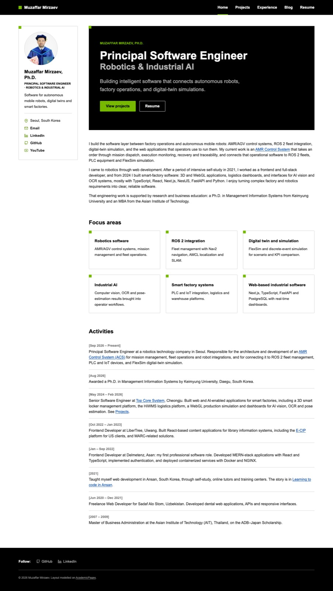
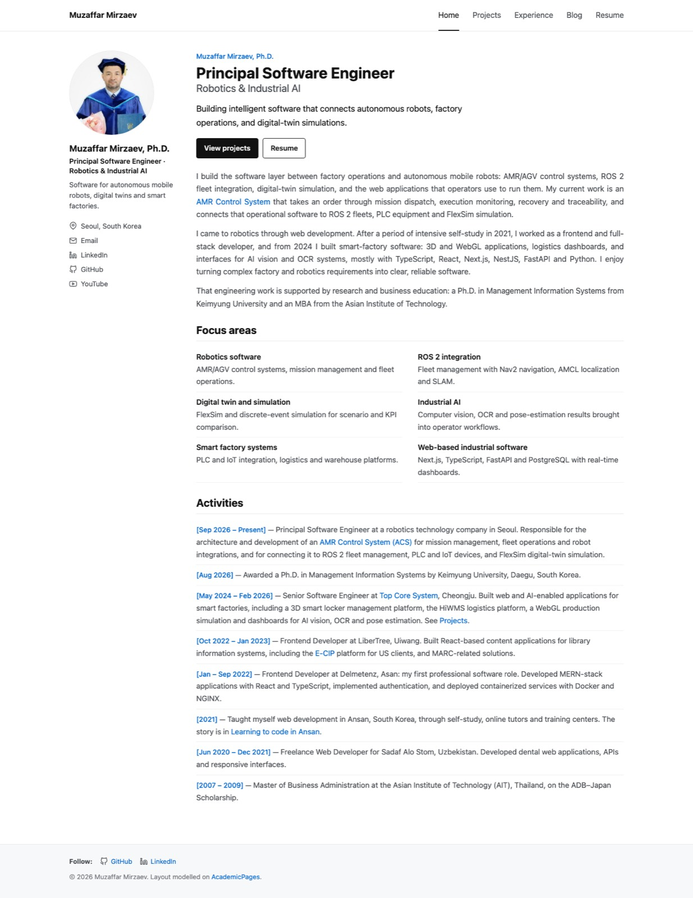
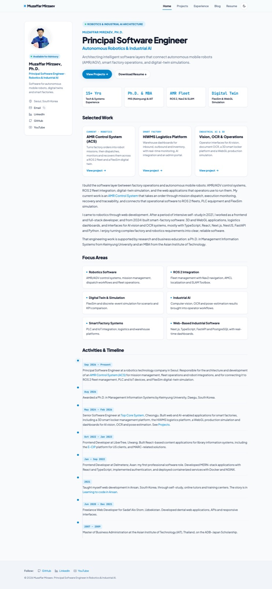
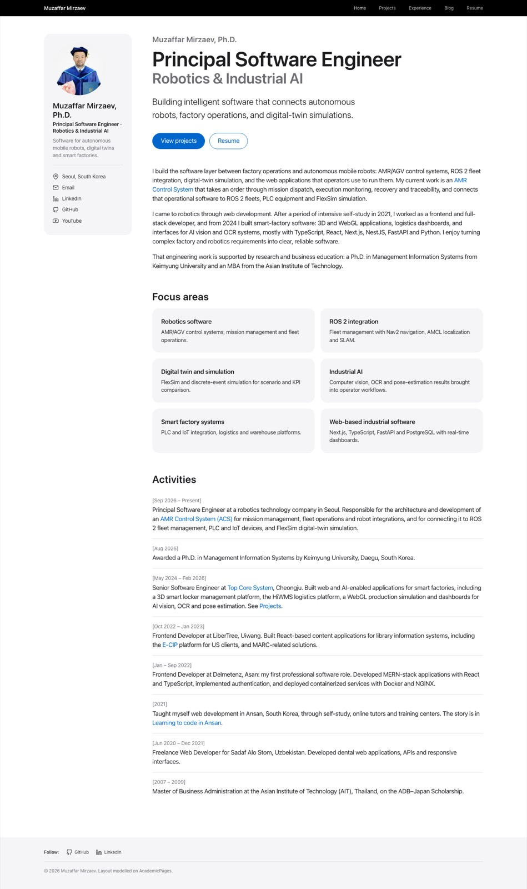
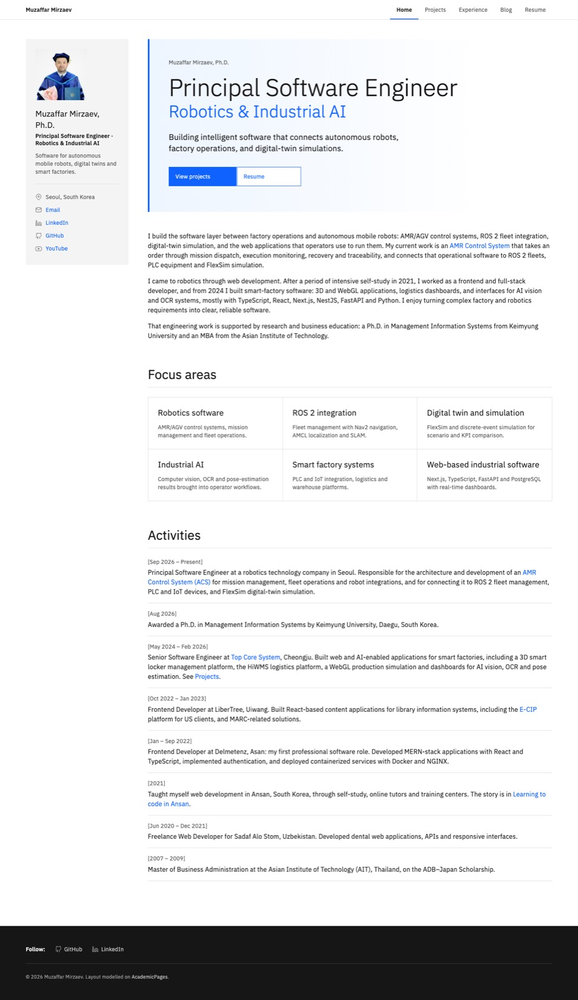
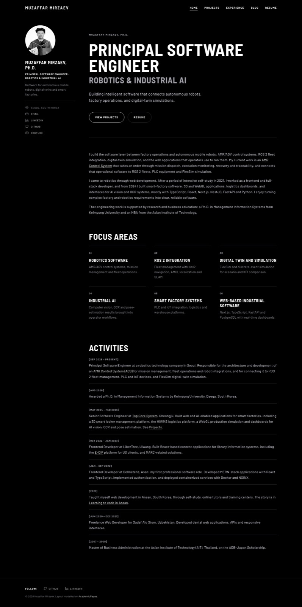
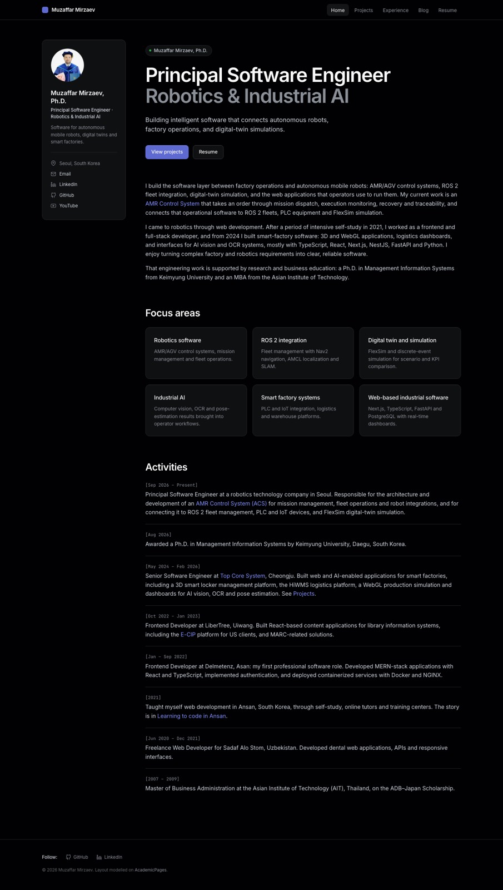
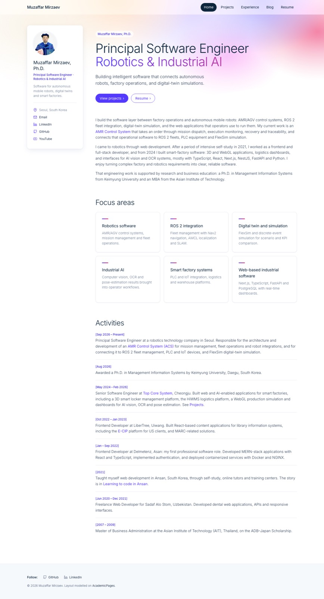
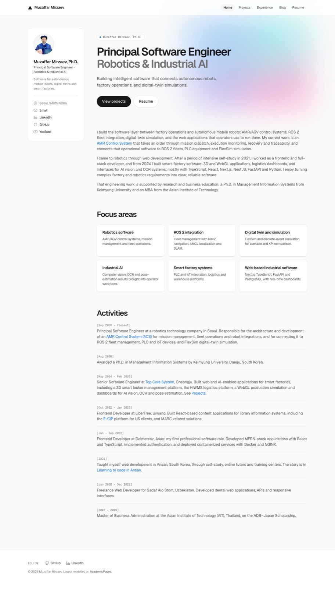

# Muzaffar Mirzaev — Portfolio

Personal portfolio site of Muzaffar Mirzaev, Ph.D., Principal Software Engineer working on robotics
and industrial AI: AMR control systems, ROS 2, digital twins and smart-factory software.

**Live site:** https://mmp17.github.io/portfolio/

## Design variants

The same site in several visual styles, one branch each. Every screenshot below is the home page of that branch, so you can compare them without running anything. Design branches carry the reference spec they follow in `DESIGN.md`, taken from [awesome-design-md](https://github.com/VoltAgent/awesome-design-md).

### This branch: NVIDIA (`nvidia-design`)

Engineering-grade: black nav and footer chapters, NVIDIA Green as the only accent, 2px corners everywhere, hairline cards marked with small green corner squares, bold Arial.

[Browse branch](https://github.com/mmp17/portfolio/tree/nvidia-design) · [Download ZIP](https://github.com/mmp17/portfolio/archive/refs/heads/nvidia-design.zip) · [Reference design](https://github.com/VoltAgent/awesome-design-md/tree/main/design-md/nvidia)



### Other branches

To get one locally:

```bash
git clone -b <branch> https://github.com/mmp17/portfolio.git
```

<table>
  <tr>
    <td width="50%" valign="top">
      <a href="screenshots/develop.jpg"></a>
      <p><strong>Original</strong> · <code>develop</code></p>
      <p>The live site. Layout modelled on the AcademicPages theme: white page, profile sidebar, simple lists and system fonts.</p>
      <p><a href="https://github.com/mmp17/portfolio/tree/develop">Browse branch</a> · <a href="https://github.com/mmp17/portfolio/archive/refs/heads/develop.zip">Download ZIP</a></p>
    </td>
    <td width="50%" valign="top">
      <a href="screenshots/improve.jpg"></a>
      <p><strong>Improve</strong> · <code>improve</code></p>
      <p>Work branch. Its content and design currently match <code>develop</code>.</p>
      <p><a href="https://github.com/mmp17/portfolio/tree/improve">Browse branch</a> · <a href="https://github.com/mmp17/portfolio/archive/refs/heads/improve.zip">Download ZIP</a></p>
    </td>
  </tr>
  <tr>
    <td width="50%" valign="top">
      <a href="screenshots/improve-two.jpg"></a>
      <p><strong>Improve Two</strong> · <code>improve-two</code></p>
      <p>Modern dual-theme redesign with a light/dark toggle, selected-work cards, stat tiles and an activity timeline.</p>
      <p><a href="https://github.com/mmp17/portfolio/tree/improve-two">Browse branch</a> · <a href="https://github.com/mmp17/portfolio/archive/refs/heads/improve-two.zip">Download ZIP</a></p>
    </td>
    <td width="50%" valign="top">
      <a href="screenshots/apple-design.jpg"></a>
      <p><strong>Apple</strong> · <code>apple-design</code></p>
      <p>Photography-first and quiet: SF Pro type with tight headline tracking, 17px body, a single Action Blue for every link and button, pill buttons, soft parchment cards and no shadows.</p>
      <p><a href="https://github.com/mmp17/portfolio/tree/apple-design">Browse branch</a> · <a href="https://github.com/mmp17/portfolio/archive/refs/heads/apple-design.zip">Download ZIP</a> · <a href="https://github.com/VoltAgent/awesome-design-md/tree/main/design-md/apple">Reference design</a></p>
    </td>
  </tr>
  <tr>
    <td width="50%" valign="top">
      <a href="screenshots/ibm-design.jpg"></a>
      <p><strong>IBM</strong> · <code>ibm-design</code></p>
      <p>Carbon Design System: IBM Plex Sans with light-weight display headings, IBM Blue as the one accent, square corners, shared-hairline tile grid, line tabs and a charcoal footer.</p>
      <p><a href="https://github.com/mmp17/portfolio/tree/ibm-design">Browse branch</a> · <a href="https://github.com/mmp17/portfolio/archive/refs/heads/ibm-design.zip">Download ZIP</a> · <a href="https://github.com/VoltAgent/awesome-design-md/tree/main/design-md/ibm">Reference design</a></p>
    </td>
    <td width="50%" valign="top">
      <a href="screenshots/spacex-design.jpg"></a>
      <p><strong>SpaceX</strong> · <code>spacex-design</code></p>
      <p>Austere black canvas, uppercase DIN-style headings (Barlow) with wide tracking, caps nav, ghost pill buttons and no accent colour; photography supplies the only colour.</p>
      <p><a href="https://github.com/mmp17/portfolio/tree/spacex-design">Browse branch</a> · <a href="https://github.com/mmp17/portfolio/archive/refs/heads/spacex-design.zip">Download ZIP</a> · <a href="https://github.com/VoltAgent/awesome-design-md/tree/main/design-md/spacex">Reference design</a></p>
    </td>
  </tr>
  <tr>
    <td width="50%" valign="top">
      <a href="screenshots/linear-design.jpg"></a>
      <p><strong>Linear</strong> · <code>linear-design</code></p>
      <p>Near-black canvas with a charcoal surface ladder, lavender used only for the brand mark, primary button and links, Inter type, pill toggles and mono changelog-style dates.</p>
      <p><a href="https://github.com/mmp17/portfolio/tree/linear-design">Browse branch</a> · <a href="https://github.com/mmp17/portfolio/archive/refs/heads/linear-design.zip">Download ZIP</a> · <a href="https://github.com/VoltAgent/awesome-design-md/tree/main/design-md/linear.app">Reference design</a></p>
    </td>
    <td width="50%" valign="top">
      <a href="screenshots/stripe-design.jpg"></a>
      <p><strong>Stripe</strong> · <code>stripe-design</code></p>
      <p>Gradient mesh across the top of every page, navy ink with an indigo accent, thin Inter display type, indigo pill buttons, soft blue-shadow cards and a deep-navy featured project.</p>
      <p><a href="https://github.com/mmp17/portfolio/tree/stripe-design">Browse branch</a> · <a href="https://github.com/mmp17/portfolio/archive/refs/heads/stripe-design.zip">Download ZIP</a> · <a href="https://github.com/VoltAgent/awesome-design-md/tree/main/design-md/stripe">Reference design</a></p>
    </td>
  </tr>
  <tr>
    <td width="50%" valign="top">
      <a href="screenshots/vercel-design.jpg"></a>
      <p><strong>Vercel</strong> · <code>vercel-design</code></p>
      <p>Near-white canvas and black ink, Geist and Geist Mono, a mesh-gradient glow behind the hero, black and white pill buttons, stacked-shadow cards and mono technical labels.</p>
      <p><a href="https://github.com/mmp17/portfolio/tree/vercel-design">Browse branch</a> · <a href="https://github.com/mmp17/portfolio/archive/refs/heads/vercel-design.zip">Download ZIP</a> · <a href="https://github.com/VoltAgent/awesome-design-md/tree/main/design-md/vercel">Reference design</a></p>
    </td>
  </tr>
</table>

## Pages

| Page | Path | Content |
| --- | --- | --- |
| Home | `index.html` | Introduction, focus areas and activity timeline |
| Projects | `projects/index.html` | Robotics and digital twin, smart factory and AI, web applications, earlier projects |
| Experience | `experience/index.html` | Work history, education, core technologies, languages |
| Blog | `blog/index.html` | YouTube podcasts, IT articles, personal posts (tabs) |
| Resume | `resume/index.html` | Resume and portfolio links, contact details, map |

`cv/index.html` only redirects the old address to `resume/`.

## Stack

Plain HTML, CSS and JavaScript. There is no build step and no dependencies.

```
index.html
projects/  experience/  blog/  resume/   one index.html each
blog/articles/_template.html    starting point for an IT article
assets/css/style.css            single stylesheet, responsive
assets/js/site.js               mobile menu, Follow toggle, blog tabs, photo carousel, email link
images/                         avatar, favicon and blog photos
```

The header, sidebar, footer and the metadata in `<head>` are repeated in every HTML file, so a
change to them has to be made in each one.

## Adding content

- **IT article:** copy `blog/articles/_template.html` to `blog/articles/<slug>.html` and follow the
  comment at the top of its `<main>`. Then link it from the IT tab in `blog/index.html`.
- **Podcast episode:** copy the commented episode template above the list in the podcasts tab of
  `blog/index.html` and append it to the list.
- **Personal post:** put the photos in `images/blog/<slug>/` and a 480 px copy of each in
  `images/blog/<slug>/thumbs/`. The page shows the thumbnails and the carousel opens the originals.

  ```bash
  cd images/blog/<slug> && mkdir -p thumbs
  for f in *.jpg; do sips -Z 480 -s formatOptions 55 "$f" --out "thumbs/$f"; done
  ```
- **Project status:** the status labels on the Projects page are documented in a comment above the
  AMR Control System entry.

## Run locally

Open `index.html` in a browser, or serve the folder:

```bash
python3 -m http.server 8000
# http://localhost:8000
```

## Deployment

The site is served by GitHub Pages from the root of the `develop` branch. Pushing to `develop`
publishes the change within a minute or two.

## Credits

- Layout modelled on the [AcademicPages](https://github.com/academicpages/academicpages.github.io) theme.
- Icons from [Feather](https://feathericons.com/) (MIT).

## Contact

- GitHub: [mmp17](https://github.com/mmp17)
- LinkedIn: [mirzaevmuzaffar](https://www.linkedin.com/in/mirzaevmuzaffar/)
